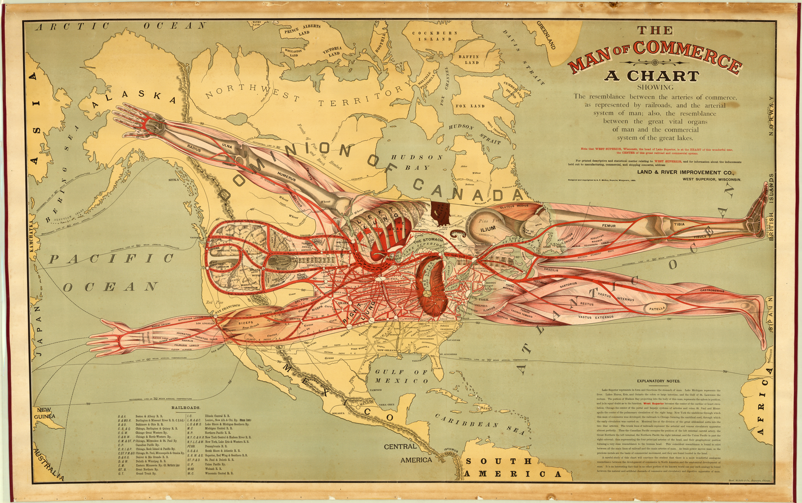

**UPDATE PHOTO**

# Make Art Maps

- Pre-workshop activities: 00 min 
- Introductory presentation: 00 min
- Hands-on activities: 00-00 min

## What is an art map? 

An art map is a map that combines geospatial, or mapping, data and artistic interpretation. 

A pictoral map, for example, is a type of an art map that emphasizes artistic impression over location precision. 

 

Image by Augustus F. McKay, http://www.wdl.org/en/item/6770/, Public Domain, https://commons.wikimedia.org/w/index.php?curid=27470915

## Why make art maps?

Making art maps is a fun way to combine geospatial information and creative practices. 

Depending on how you make them, art maps can teach us to see and use geospatial tools and related technologies in new ways. 

This workshop's tutorial on making art maps out of laser cut plywood, for example,teaches you about how to work with Scalable Vector Graphic (SVG) files, digital mapping resources, and how to produce an output file suitable for laser cutting. 

[EXMAPLE IMAGE OF STUBBS ISLAND or SATURNA MAP]

## Learning objectives

In this workshop, you will **learn about the following:** 
- different kinds of art maps
- some of the tools and options to choose from when making your own art map
- Inkscape: a free, cross-platform image editing program
- laser cutting (if you complete the laser cutting module)

In this workshop, you will **learn to do the following:** 
- identify the differences between accurate geospatial maps and art maps 
- use Inkscape to create and edit an SVG file from a digital image
- create an SVG image file suitable for laser cutting at the DSC (laser cutting module)
- choose the appropriate types of plywood for your laser cut art map (laser cutting module)

## Choose your art map options

In the coming years, we intend to create modules on making art maps in a variety of ways, from analogue and digital collage to 3D printing, and other creative options. 

To get our art map workshop modules started, we offer a module on making laser cut maps—a process we get asked about regularly. 
 
[NEXT STEP: Pre-Workshop Activities](pre-workshop.html){: .btn .btn-blue }
